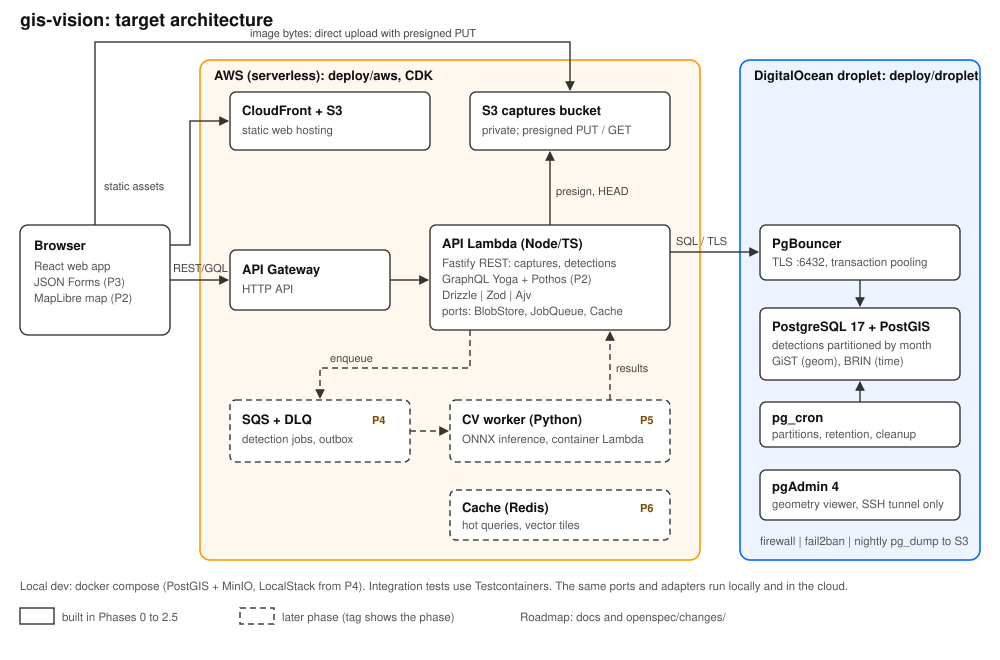

# gis-vision

A geospatial detection service. Images (captures) are uploaded, then detectors (a human first, ML later) record what they found, located in **space and time**, in PostGIS. The project is a portfolio piece showing Node.js/TypeScript, REST + GraphQL, PostGIS and time-series data, serverless/IaC, distributed systems and testing.



## Stack

Node/TS (Fastify, GraphQL Yoga + Pothos, Drizzle, Zod) | PostgreSQL 17 + PostGIS | React + JSON Forms + MapLibre | Python ONNX worker (later) | AWS Lambda/S3/SQS (CDK) + a DigitalOcean droplet for the database | Vitest + Testcontainers.

## Status & roadmap

Planned with [OpenSpec](https://github.com/Fission-AI/OpenSpec). Each phase is one change in `openspec/changes/` and is implemented **one feature at a time**.

| Phase | Change                            | Focus                                                             |
| ----- | --------------------------------- | ----------------------------------------------------------------- |
| 0+1   | `bootstrap-geo-detection-service` | scaffold, REST captures (presigned upload), detectors, detections |
| 2     | `phase-2-graphql-geo-queries`     | GraphQL, bbox/radius/time queries, map                            |
| 2.5   | `phase-2-5-deploy-v0`             | AWS serverless + PostGIS droplet                                  |
| 3     | `phase-3-schema-driven-ui`        | UI generated from schemas                                         |
| 4     | `phase-4-async-processing`        | queue, outbox, retries, DLQ                                       |
| 5     | `phase-5-cv-worker`               | Python CV detector                                                |
| 6     | `phase-6-caching-performance`     | vector tiles, caching, load tests                                 |
| 7     | `phase-7-iac-production-deploy`   | CDK + Terraform, CD                                               |
| 8     | `phase-8-hardening`               | tracing, auth, rate limits                                        |

Only Phase 0+1 is fully planned. The others are skeletons (proposal only), planned when the previous phase is archived.

## Getting started

Prerequisites: Node LTS, pnpm, Docker Desktop (needed by Compose and Testcontainers), and the [OpenSpec CLI](https://github.com/Fission-AI/OpenSpec) with Claude Code.

Code is scaffolded feature by feature; setup commands land in this README as the features are built (F0.2 adds `docker compose up -d`).

## OpenSpec workflow

```
/opsx:explore                                         # think, no code
/opsx:propose <change>                                # write specs + design + tasks.md
/opsx:apply <change> only F0.1                        # build ONE feature, then review + commit
/opsx:apply <change> only F0.2                        # ...next feature
/opsx:archive <change>                                # specs move into openspec/specs/
/opsx:propose phase-2-graphql-geo-queries             # plan the next phase
```

Useful CLI commands: `openspec list` (changes), `openspec list --specs` (archived capabilities), `openspec status --change <name>`, `openspec validate <name> --strict`.

### Configuration tips

- `openspec/config.yaml` sets `schema: spec-driven` (proposal -> specs + design -> tasks). Optional keys:
  - `context`: project constraints applied to every artifact.
  - `rules.<artifact>`: per-artifact rules.
  - `operations.apply.guidance`: e.g. "implement only the requested feature group, then stop".
- Keep `config.yaml` to constraints an agent can't infer from the code; don't paste docs into it.
- `/opsx:*` commands and skills live in `.claude/`. Commit them so the workflow travels with the repo.

### OpenSpec gotchas

- Create changes with `openspec new change <name>`, never by hand; the CLI writes the `.openspec.yaml` metadata.
- Spec scenarios need **exactly** `#### Scenario:` (4 hashes) or they're silently ignored. Every requirement needs at least one scenario.
- Only `- [x]` counts as a done task. `- [~]` and `- []` read as unfinished.
- Skeleton changes fail `openspec validate` ("no deltas") until their specs exist. That's expected.
- `openspec list --specs` stays empty until the first change is archived.
- Explore mode only writes planning artifacts. Code changes happen through `/opsx:apply`.

## Project gotchas

- **Uploads are presigned:** Lambda/API Gateway cap request bodies at about 6MB, so image bytes go straight to S3/MinIO, never through the API.
- **PostGIS lives in the `extensions` schema:** this keeps `spatial_ref_sys` out of `public` and avoids ORM migration drift.
- **`detection` is partitioned by month:** its primary key is `(id, observed_at)` and it can't be the target of foreign keys. Partitions are created ahead of time, with a DEFAULT partition as a safety net.
- **No TimescaleDB:** it isn't portable (Supabase dropped it on PG17), so the project uses native partitioning + BRIN.
- **Lambda has no static outbound IP:** the droplet database is protected by TLS, PgBouncer, strong credentials and fail2ban, not an IP allowlist (a NAT gateway would cost about $32/mo).
- **Windows:** Testcontainers needs Docker Desktop running.
